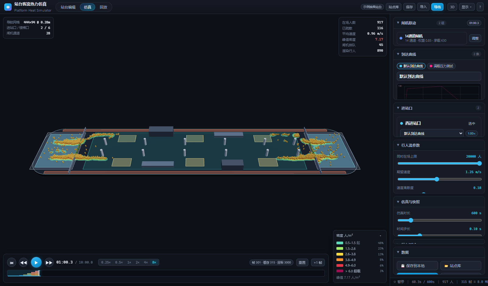

# 站台客流热力仿真 · Platform Heat Sim

基于 **TypeScript + React + three.js + three-mesh-bvh** 的站台客流热力仿真工具。全部数据保存在浏览器本地（IndexedDB），可通过导出压缩包分享。



## 功能

### 1. 站台编辑
- **导入/绘制平面轮廓**：内置 80×22、124×26、160×30 三种站台模板，也可用多边形工具逐点绘制外轮廓（双击或 Enter 闭合）。
- **多边形圈定区块**：付费区、非付费区、楼梯口、进站口、站台边缘及自定义区块；每个区块可设为**行人投放点**（进站口，绑定到达曲线）或**疏散点**（楼梯口，带服务率）。
- **障碍物**：闸机、扶梯、立柱、楼梯、护栏、商铺。支持拖动移动、旋转、改尺寸、删除、撤销/重做。
- 每个障碍物带 **通行权重**（0.02–1）与 **最大承载人数**；闸机按通道拆分，每通道独立权重/承载。
- 扶梯带传送速度，行人在扶梯上额外获得带速。

### 2. 行人流生成
- 按**到达曲线**（分段线性，可拖拽控制点）在进站口投放，支持多条曲线与多进站口叠加权重。
- 个体参数：期望速度（正态分布）、半径、社会力排斥、密度-速度基本图。
- 引导：多汇点 Dijkstra 流场（双线性采样）+ **位置级分离（PBD）** + **BVH 扇形射线避让**。
- 支持 **20000 人同时在场**的压力测试（`压力测试 → 填 20,000 人`）。

### 3. 热力渲染
- 把行人位置栅格化为 **512×512** 密度纹理（物理空间核密度 + 可分离模糊，避免长条站台的各向异性失真）。
- 按 **0.5–1.5 / 1.5–2.6 / 2.6–3.8 / 3.8–4.9 / 4.9–6.0 人/m² 五档配色**，>6 显示超载色。
- 自定义 shader 叠加到站台几何上做半透明混合；`depthTest` + 不透明队列先绘制保证**立柱遮挡处排序正确**；支持连续渐变模式与不透明度调节。

### 4. 时间轴与回放
- **每 200ms 一帧**记录密度快照，4bit 量化 + zlib 压缩（约 25KB/帧）。
- 播放头驱动，Worker 预生成帧；帧缓存 + 引擎检查点，**未命中时回退到最近检查点分块重算**。
- 拖动回放时对相邻两帧做**量化域线性插值**，5 帧/秒的序列也能平滑过渡。
- **回放中修改闸机权重 → 从当前帧向后联动重算**（带进度），之前的帧保留以便对比。导入的回放包使用导出的行人快照续算。

### 5. 数据与导出
- 站点文档自动/手动保存到 IndexedDB；站点库、回放库。
- 导出 `.phs.zip`：
  - `manifest.json`：格式版本、站点信息、参数、五档色带、几何摘要、文件索引
  - `station.json`：完整站点文档（轮廓/区块/障碍物/曲线/参数）
  - `frames/fNNNNNN.bin`：每帧 4bit+deflate 的 512×512 密度栅格
  - `stats.json`：逐帧人数/均速/最大密度/五档像素数/通过人数/闸机排队
  - `agents/aNNNNNNN.bin`：行人快照（x,z,heading,phase f32 + state u8）
  - `curves.csv`、`gate-events.json`、`README.txt`
- 导入后自动存入回放库并进入回放模式。

## 开发

```bash
npm install
npm run dev        # http://localhost:5173
npm run build      # 类型检查 + 产物到 dist/
npm run preview
```

### 测试

```bash
npm test                          # 12 项: 几何/编解码/仿真确定性/无死锁疏散/导出闭环/异常包
npm run bench                     # 20000 人同时在场性能
node tests/bench.ts               # 到达曲线驱动下的步长基准
npm run test:e2e                  # Playwright 浏览器冒烟 (需先 npm run dev)
```

基准（Ryzen 级别桌面 CPU，Node 26）：

| 场景 | 每步耗时 (dt=0.1s) | 说明 |
| --- | --- | --- |
| 8000 人 | ~24 ms | 含栅格化外的全部物理 |
| 20000 人 | ~40 ms | 峰值密度场与渲染仍可交互 |

## 目录

```
src/
  core/      types / geometry / format(色带与帧编码) / defaults / export / storage
  sim/       nav(导航网格+流场) spatial(空间哈希) avoid(BVH 射线) density(栅格化) engine
  workers/   sim.worker.ts (预取/回退/联动重算/导出) + protocol
  state/     store(zustand) liveClient(Worker 客户端、帧插值)
  three/     scene(站台几何、热力叠加、拾取) shaders
  ui/        Viewport / Timeline / Legend / CurveEditor / 各功能模块 / 数据操作
tests/       单元测试、基准、Playwright 脚本
```

## 关键实现说明

**密度栅格不是直接计数**：站台 124m×26m 映射到 512×512 纹理时，单个纹理像素的物理面积相差约 9 倍，直接按像素计数会让单人被算成几十人/m²。`sim/density.ts` 在物理空间做核密度估计（各向同性的可分离盒式模糊，σ≈0.6m），再除以像素物理面积，保证均匀密度场守恒、单人峰值约 0.44 人/m²（低于第一档，不显示）。

**闸机是"半透膜"**：通道净宽 0.68m，若把机箱作为实体墙参与碰撞，扣除行人半径后几乎无余量，会形成死锁。这里把闸机在导航网格中表示为带通行代价的膜（权重→代价与限速，承载人数→拥堵衰减），实体碰撞只作用于立柱、护栏、商铺等。

**避免密集人群死锁**：速度层的斥力在密集时衰减且只保留较弱的反向分量；真正的"不穿模"由位置级分离（PBD，每步投影重叠）完成，保证人群被推成有序队列而不是互相顶住。

**确定性回放**：仿真使用可序列化状态的 mulberry32，时间由步数精确导出（`time = stepCount × dt`），检查点保存 RNG/步数/spawn 累加器/汇点令牌，因此"回退到检查点后重算"与原始轨迹逐位一致（有单元测试保证）。
